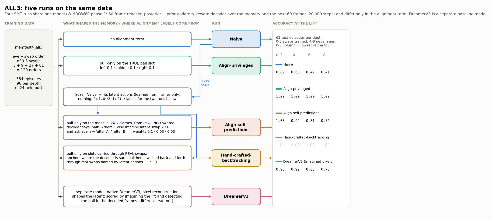
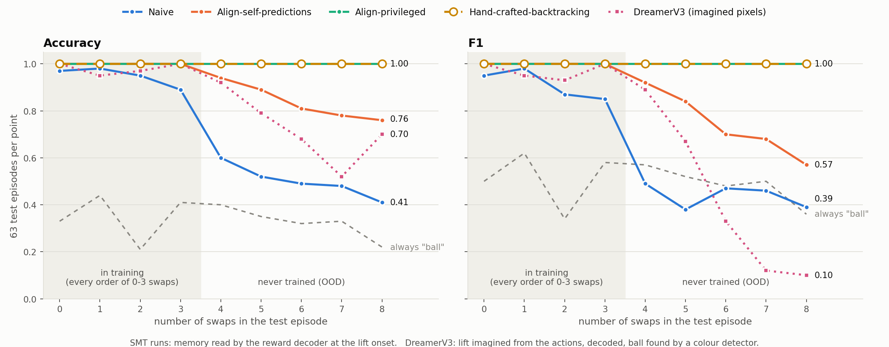
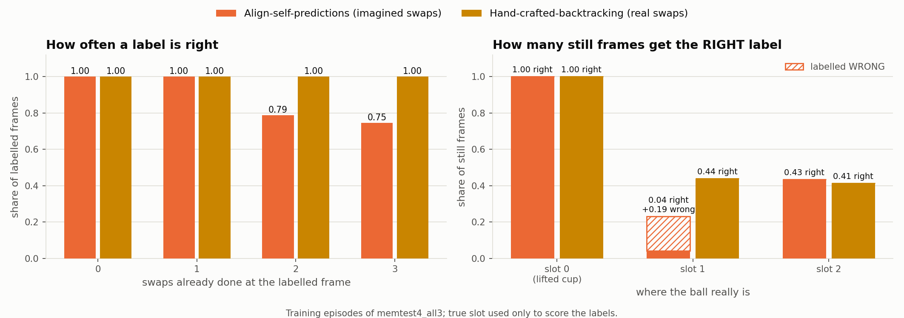

# ALL3: Naive vs Align-self-predictions vs Hand-crafted-backtracking vs Align-privileged (trained on every 0–3-swap order)

2026-10-08, with Hand-crafted-backtracking added 2026-10-11. The runs are identical except for the alignment term. All of them are trained on every swap order of 0–3 swaps, then tested on 0–3 swaps (trained, but new timings) and on 4–8 swaps (never trained).

**Headline:** Hand-crafted-backtracking uses no privileged labels and matches Align-privileged exactly. Its posterior is right on all 567 test episodes, from 0 to 8 swaps. Its labels come from the frozen Naive decoder's sure moments, carried through the real swaps (see [Hand-crafted-backtracking](#hand-crafted-backtracking)).



*Figure 1. How each run is built, with accuracy at the lift (0–3 column = the lowest of the four trained depths).*

## Setup

**Model, the same for all three.** WINDOW60 SMT phase 1, 20,000 steps, batch 128:
- the teacher encodes a 60-frame window;
- a posterior and a prior update the memory one step at a time;
- the reward decoder reads the memory plus the next 60 frames (paired layout, sees future frames) and is scored on "ball revealed" at lift offsets 1–9.

**Training data:** `data/memtest4_all3.zarr`, built by `scripts/build_all_orders_data.py`.
- It contains every order of 0–3 swaps: 3 + 9 + 27 + 81 = 120.
- 384 training episodes, 96 per depth, with every order present at least once. The order is forced by searching episode seeds, and the replay check confirms each one.
- 24 extra random 0–3 episodes at the end form the held-out loss.

**Alignment term.** It only acts at still hold frames, and it only pulls frames of the same class together: no separation term, no uniformity term.

| run | classes | pull weight per class |
|---|---|---|
| **Naive** | none | – |
| **Align-privileged** | the true ball slot | left (slot 0, the lifted cup) 0.1 · middle 0.1 · right 0.1 |
| **Align-self-predictions** | the model's own prediction, at most one class per frame | "here" 0.1 · "after A" 0.03 · "after B" 0.03 |
| **Hand-crafted-backtracking** | slot 0 / α / β, from the decoder's sure moments carried through real swaps | 0.1 · 0.1 · 0.1 |

**How the Align-self-predictions labels are made, without labels:**
1. Train Naive, then freeze it.
2. Learn latent actions on the frozen Naive (`scripts/train_latent_action_prior_phase1.py`). An inverse model reads a 6-frame block of frames only and outputs one of 16 codes. A prior plays a code forward from the memory. It ends up using exactly 4 codes: nothing, 0↔1, 0↔2, 1↔2, each 100% pure on test blocks.
3. Pick the two swap actions without labels:
   - exclude the code the frames show most often (that's "nothing", 71% of blocks);
   - take the two codes that flip the decoder's own "ball here?" answer most.
   
   It picked the 0↔2 and 0↔1 codes, which is correct (true names were used for checking only).
4. Label every still frame (`scripts/psr_labels_phase1.py`, `scripts/build_psr_align_labels.py` → `data/labels_psr_self_all3naive.npz`):
   - the decoder says "ball" → **here**;
   - otherwise, imagine swap A and ask again → **after A**;
   - otherwise, imagine swap B and ask again → **after B**;
   - both or neither → no class.

**Test sets:** 63 episodes per depth, the same episodes for every run.

| swaps | store |
|---|---|
| 0–4 | `memtest4_eval` |
| 5–8 | `memtest4_eval5`–`memtest4_eval8` (6–8 added for this experiment: `configs/data/memtest4_eval{6,7,8}.yaml`, embeddings cached) |

**Score:** the posterior chained over the real frames to the lift onset, read by the frozen reward decoder with no future frames (`posterior_r1` from `onset-probe-phase1`). No confidence intervals.

## Results



*Figure 2. Accuracy and F1 by number of swaps. Hand-crafted-backtracking (dashed, hollow) lies exactly on Align-privileged at 1.00. DreamerV3 (dotted, squares) is scored through imagined pixels rather than the memory read-out; see [its section](#baseline-native-dreamerv3).*

### F1

| swaps | Naive | Align-self-predictions | Hand-crafted-backtracking | Align-privileged | always "ball" |
|---|---|---|---|---|---|
| 0 (trained) | 0.95 | 1.00 | 1.00 | 1.00 | 0.50 |
| 1 (trained) | 0.98 | 1.00 | 1.00 | 1.00 | 0.62 |
| 2 (trained) | 0.87 | 1.00 | 1.00 | 1.00 | 0.34 |
| 3 (trained) | 0.85 | 1.00 | 1.00 | 1.00 | 0.58 |
| 4 (OOD) | 0.49 | 0.92 | **1.00** | **1.00** | 0.57 |
| 5 (OOD) | 0.38 | 0.84 | **1.00** | **1.00** | 0.52 |
| 6 (OOD) | 0.47 | 0.70 | **1.00** | **1.00** | 0.48 |
| 7 (OOD) | 0.46 | 0.68 | **1.00** | **1.00** | 0.50 |
| 8 (OOD) | 0.39 | 0.57 | **1.00** | **1.00** | 0.36 |

### Accuracy

| swaps | Naive | Align-self-predictions | Hand-crafted-backtracking | Align-privileged | always "ball" |
|---|---|---|---|---|---|
| 0 (trained) | 0.97 | 1.00 | 1.00 | 1.00 | 0.33 |
| 1 (trained) | 0.98 | 1.00 | 1.00 | 1.00 | 0.44 |
| 2 (trained) | 0.95 | 1.00 | 1.00 | 1.00 | 0.21 |
| 3 (trained) | 0.89 | 1.00 | 1.00 | 1.00 | 0.41 |
| 4 (OOD) | 0.60 | 0.94 | **1.00** | **1.00** | 0.40 |
| 5 (OOD) | 0.52 | 0.89 | **1.00** | **1.00** | 0.35 |
| 6 (OOD) | 0.49 | 0.81 | **1.00** | **1.00** | 0.32 |
| 7 (OOD) | 0.48 | 0.78 | **1.00** | **1.00** | 0.33 |
| 8 (OOD) | 0.41 | 0.76 | **1.00** | **1.00** | 0.22 |

Hand-crafted-backtracking, exact counts (posterior): 315/315 on 0–4 swaps, and 63/63 on each of 5, 6, 7 and 8 swaps.

### Quality of the Align-self-predictions labels

3,613 still frames from 384 training episodes, teacher memory. The true slot is shown for checking only.

| class | frames | true slot 0 / 1 / 2 |
|---|---|---|
| here | 1,203 | 1.00 / 0.00 / 0.00 |
| after the 0↔2 action | 751 | 0.00 / **0.30** / 0.70 |
| after the 0↔1 action | 50 | 0.00 / 1.00 / 0.00 |
| no class | 1,609 | 0.00 / 0.58 / 0.42 |

56% of still frames get a class, and 89% of those are in their class's majority slot. The errors are all of one kind: 19% of the frames with the ball in slot 1 land in the 'after 0↔2' class, whose other members are slot 2 (Figure 3). By swaps done, that's 100%, 100%, 79% and 75%. For comparison, the earlier Align-self-predictions run (trained on 0–4 swaps) had labels that were 98% right.

### Where the imagined swaps fail

Is the decoder right after an imagined swap? The cases that make labels, on training frames. "+more" means a real swap comes next; "last" means the cups only sit still from here on.

| swaps already done | 0, +more | 0, last | 1, +more | 1, last | 2, +more | 2, last | 3, last |
|---|---|---|---|---|---|---|---|
| frames | 288 | 749 | 192 | 750 | 96 | 780 | 758 |
| no imagination | 1.00 | 1.00 | 1.00 | 1.00 | 1.00 | 1.00 | 1.00 |
| imagine 0↔1, ball in slot 1 (should say ball) | **1.00** | 0.26 | 0.33 | 0.27 | 0.21 | 0.14 | 0.09 |
| imagine 0↔1, ball in slot 2 (should say no) | 1.00 | 1.00 | 1.00 | 1.00 | 1.00 | 1.00 | 1.00 |
| imagine 0↔2, ball in slot 2 (should say ball) | **1.00** | 0.25 | 0.83 | 0.43 | 0.55 | 0.40 | 0.32 |
| imagine 0↔2, ball in slot 1 (should say no) | 0.00 | 0.74 | 0.67 | 0.83 | 0.21 | 0.52 | 0.57 |

- **Imagined swaps only move the ball from the first state,** just after the cups go down with a swap coming. After one real swap, or from any idle state, they rarely do.
- **The earlier run (trained on 0–4 swaps) collapsed the same way.** There, imagining 0↔1 with the ball in slot 1 said "ball" 1.00 at 0 swaps done, then 0.00 after one swap.
- **The latent-action prior only ever saw a swap start where a real swap started.** A swap never follows idle in the data, yet about 85% of still frames are idle.
- **The two runs differ in how they fail.** In ALL3, imagining 0↔2 also says "ball" when the ball is in slot 1, which is what contaminates the "after 0↔2" class. Imagining 0↔1 almost never says "ball", which is why its class is so small.

## Hand-crafted-backtracking

Added 2026-10-11. This run drops imagination entirely. The labels come from **real** episodes: start at the moments when the frozen Naive decoder is sure the ball is under the lifted cup, then carry that knowledge backwards and forwards through the swaps that really happened.

**Building the labels** (`scripts/backtrack_labels_phase1.py` → `data/labels_backtrack_all3naive.npz`), in each training episode:
1. **Still frames:** a frame identical to the previous one while the hold flag is on.
2. **Segments:** each stretch between consecutive still frames. One frame means nothing moved; six frames means a swap.
3. **Naming each swap** with the 4-code latent-action inverse model (frames only).
4. **Which code is which, without labels.** A real swap that involves slot 0 flips the decoder's own "ball if we lift now?" across the segment; the swap of the other two cups never does. The measured flip rates were 0.66 and 0.65 for two codes and 0.00 for the third, giving:
   - A = slot 0 ↔ α
   - B = slot 0 ↔ β
   - C = α ↔ β
   
   Checked against the true names (scoring only): A = 0↔1, B = 0↔2, C = 1↔2.
5. **Anchors:** still frames where the decoder says "ball here" (teacher memory, 100% right on training episodes).
6. **Walking:** from each anchor, backwards and forwards through the real swaps, so every still frame gets slot 0, α or β.
   - An episode is dropped if its anchors disagree, or if the decoder says "no ball" where the walk says slot 0. None were dropped.
   - Episodes where the ball never sits under the lifted cup get no labels: 156 of 384.

**Why "hand-crafted":**
- it assumes three slots, with every swap exchanging two of them (that's what makes C = α↔β);
- the inverse model it uses was trained on 6-frame blocks placed by the generator's swap schedule (a still-frame-trained inverse model merged 1↔2 into "nothing" and couldn't be used);
- the walking rule itself is written by hand, not learned.

The labels never use the hidden ball slot or the swap identities.

**Labels:** 3,226 still frames from 384 training episodes.

| | Align-self-predictions (imagined) | **Hand-crafted-backtracking** |
|---|---|---|
| still frames labelled | 56% | **62%** |
| labelled frames right | 89% | **100%** |
| ball in slot 1: frames labelled **right** | 4% (50), plus 19% (229) labelled **wrong** | **44%** (473), none wrong |
| ball in slot 2: frames labelled **right** | 43% (522), none wrong | **41%** (443), none wrong |
| right by swaps done (0 / 1 / 2 / 3) | 100 / 100 / 79 / 75% | **100 / 100 / 100 / 100%** |



*Figure 3. The two self-made label sets on the training episodes. Left: share of labelled frames that are right, by swaps already done. Right: share of still frames that get the right label, by where the ball really is (hatched = labelled wrong). True slot used only for scoring.*

**Training:** the same as the other runs (ALL3 data, WINDOW60, 20,000 steps, batch 128), pull-only with all three classes at 0.1, no separation, no uniformity. Config `train_all3_window60_handcrafted_backtracking_phase1.yaml`. The GPUs were shared with other users' jobs, so it ran with PyTorch's `expandable_segments` setting to fit in about 5.2 GB. That changes how memory is allocated, not the maths.

**Result:** perfect on every depth, the same as Align-privileged (tables above). The teacher, which re-reads only the last 60 frames, does worse on long episodes (52/63 at 5 swaps, 40/63 at 8). That's expected, since an 8-swap episode is up to 92 frames long. The posterior that carries the memory is perfect.

## Baseline: native DreamerV3

Added 2026-10-11. DreamerV3 trained on the same data, every order of 0–3 swaps.

**Setup:**
- **Model:** the r2dreamer code with `rep_loss: dreamer`, i.e. the native recipe where a pixel-reconstruction decoder shapes the latent (size12M). The offline wrapper previously allowed only the R2-Dreamer loss; the reconstruction mode was added to `src/world_model/models/r2dreamer/agent.py`, copied from the submodule's own loss code.
- **Training:** 25,500 steps, i.e. 1,000 passes over `memtest4_all3` at batch 16, the same rule as the earlier Dreamer baselines. It used all 408 episodes, including the 24 the SMT runs held out.
- **Config:** `configs/dreamer/train_memtest4_all3_dreamerv3.yaml`.

**Scoring (a different read-out from the SMT runs):**
1. A pixel decoder is trained on the frozen latents (20,000 steps).
2. The model watches the real frames up to the lift.
3. It imagines the lift from the actions alone.
4. The decoder draws those frames, and a colour detector looks for the ball.

The SMT columns instead read the memory with the reward decoder at the lift onset. Both ask "does the model know where the ball is?", through different outputs. The detector on the decoded *real* lift frames is 1.00 at every depth, so neither the decoder nor the detector adds errors.

| swaps | DreamerV3, accuracy | DreamerV3, F1 | always "ball" F1 |
|---|---|---|---|
| 0 (trained) | 1.00 | 1.00 | 0.50 |
| 1 (trained) | 0.95 | 0.95 | 0.62 |
| 2 (trained) | 0.97 | 0.93 | 0.34 |
| 3 (trained) | 1.00 | 1.00 | 0.58 |
| 4 (OOD) | 0.92 | 0.89 | 0.57 |
| 5 (OOD) | 0.79 | 0.67 | 0.52 |
| 6 (OOD) | 0.68 | 0.33 | 0.48 |
| 7 (OOD) | 0.52 | 0.12 | 0.50 |
| 8 (OOD) | 0.70 | 0.10 | 0.36 |

At 6–8 swaps DreamerV3 mostly imagines an empty cup, so its accuracy is propped up by the episodes where the cup really is empty (78% at 8 swaps). F1, which ignores those, falls to 0.10–0.33, below always saying "ball".

**Accuracy, all five runs:**

| swaps | Naive | DreamerV3 (imagined pixels) | Align-self-predictions | Hand-crafted-backtracking | Align-privileged |
|---|---|---|---|---|---|
| 0–3 (trained) | 0.89–0.98 | 0.95–1.00 | 1.00 | 1.00 | 1.00 |
| 4 | 0.60 | 0.92 | 0.94 | 1.00 | 1.00 |
| 5 | 0.52 | 0.79 | 0.89 | 1.00 | 1.00 |
| 6 | 0.49 | 0.68 | 0.81 | 1.00 | 1.00 |
| 7 | 0.48 | 0.52 | 0.78 | 1.00 | 1.00 |
| 8 | 0.41 | 0.70 | 0.76 | 1.00 | 1.00 |

DreamerV3 tracks better than Naive SMT within and just beyond training (0.92 at 4 swaps against 0.60), then degrades towards chance-level F1 by 7–8 swaps. Both alignment runs that carry labels through every depth stay at 1.00. In Figure 2 DreamerV3 is the dotted line.

Files:
- run: `logdir/world_model/dreamerv3_memtest4_all3/main/`;
- table: `depth_table.md` in the run folder, from `scripts/lift_eval_depth_table.py`;
- chain: `scripts/dreamerv3_all3_chain.sh`.

The eval's own `swaps` column counts only swaps that moved the ball, so the table groups episodes by their true swap count from `swap_sequences`.

## Takeaways

1. **With privileged labels and every short order in training, the model tracks perfectly to at least 8 swaps** (accuracy 1.00 at every depth). Training on short orders works; the old model trained on 0–4 swaps with privileged labels reached only 0.84 at 7 swaps.
2. **Labels from the model's own sure moments, carried through real swaps, are as good as privileged ones:** Hand-crafted-backtracking scores 1.00 everywhere. Clean labels on slots 1 and 2 at every depth were what was missing.
3. **Imagined labels get most of the way** (Align-self-predictions: 0.76 at 8 swaps, against 0.41 for Naive). Their gap matches their label errors: imagined swaps don't move the ball after the first real swap.
4. **What's still hand-made in Hand-crafted-backtracking:** the 3-slot swap rule, the hand-written walk, and an inverse model trained on schedule-placed blocks. Removing these is the next step toward fully learned labels:
   - learn the walk (how each code moves each slot);
   - get a still-frame inverse model that keeps all 4 actions.

## Reproduce

```bash
pixi run python scripts/build_all_orders_data.py                       # data/memtest4_all3.zarr
pixi run cache-embeddings-prelim 'targets=[data/memtest4_all3.zarr]'
scripts/all3_chain.sh                                                  # 3 runs, labels, probes, table (~2 h)
pixi run python scripts/onset_depth_table.py "Naive=logdir/world_model/smt_phase1_all3/naive" \
  "Align-self-predictions=logdir/world_model/smt_phase1_all3/alignselfpred" \
  "Align-privileged=logdir/world_model/smt_phase1_all3/alignpriv" --trained 0-3
python3 scripts/all3_figures.py                                        # figures/all3_by_swaps.png, all3_runs_diagram.png, all3_labels.png
# Hand-crafted-backtracking (needs the frozen Naive and its 4-code latent actions from all3_chain.sh)
pixi run python scripts/backtrack_labels_phase1.py                     # data/labels_backtrack_all3naive.npz
scripts/all3_backtrack_chain.sh                                        # train, probes, depth_table_handcrafted_backtracking.md
# DreamerV3 baseline
scripts/dreamerv3_all3_chain.sh                                        # world model, pixel decoder, imagined-lift eval, depth_table.md
```

**Where things are:**
- runs: `logdir/world_model/smt_phase1_all3/{naive,alignselfpred,handcrafted_backtracking,alignpriv}`, each with `onset_probe_EVAL{,5,6,7,8}/`;
- tables: `logdir/world_model/smt_phase1_all3/depth_table.md` (three runs) and `depth_table_handcrafted_backtracking.md` (all four);
- latent actions and labels: `logdir/world_model/smt_phase1_all3/naive/latent_action_prior/`;
- configs: `configs/smt_phase1/train_all3_window60_{naive,alignselfpred,handcrafted_backtracking,alignpriv}_phase1.yaml` and `configs/smt_phase1/data/memtest4_all3_{windows,anchors}.yaml`.
