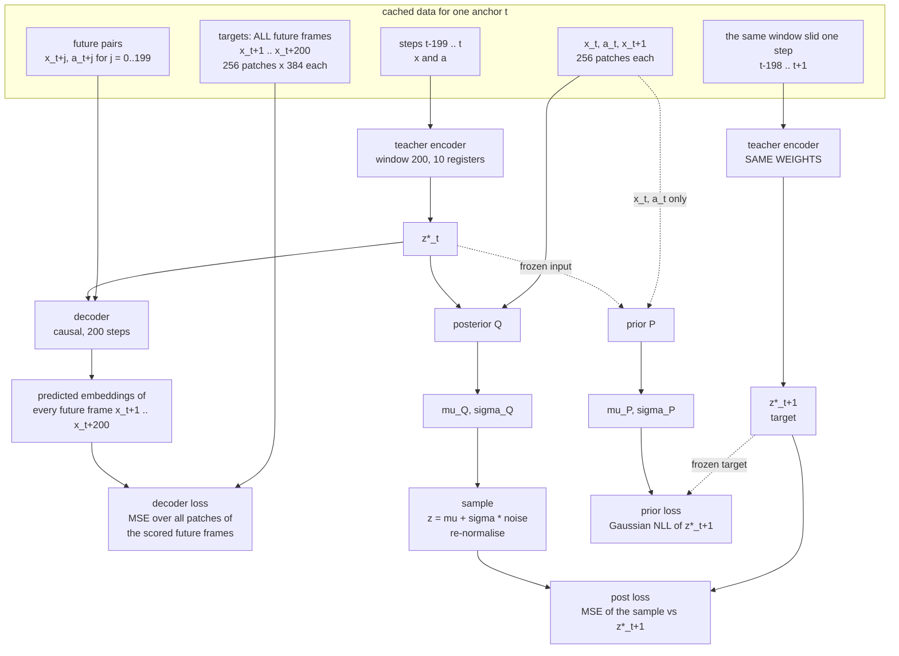
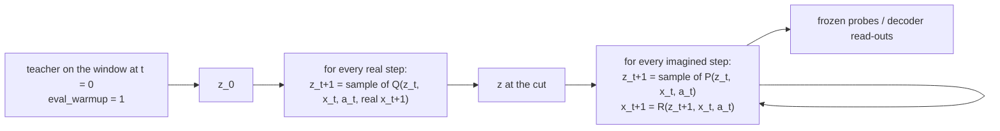

# OGBar-SMT: a stochastic SMT world model on frozen DINO tokens

**Status (2026-10-15): redesign.** Stage 1 was built with one pooled token per frame in the teacher and decoder, trained in four runs, and never held the centre of mass (see "Runs so far" at the end). This version feeds **all 256 patch tokens** of every frame into the teacher and the decoder (user, 2026-10-15). The code still has the pooled version; the all-patch version is not built yet.

| Doc | Covers |
|---|---|
| [OGBAR.md](OGBAR.md) | the environment, the play policy and the dataset |
| [SMT_PHASE1.md](SMT_PHASE1.md) | the deterministic SMT this builds on |
| [ALL3_RESULTS.md](ALL3_RESULTS.md), [ALL3U.md](ALL3U.md) | what the shell game taught us |

## Goal

**A world model whose memory holds what the camera can't see.** On OGBar that's the bar's centre of mass, together with which of its two identical-looking ends is the heavy one. The model must:
- **learn it without labels:** the centre of mass is never an input or a target;
- **carry it across a 200-step episode;**
- **say how sure it is:** wide before any probe, narrow after;
- **imagine different outcomes when they are genuinely open:** a bar lifted before anyone knows its centre of mass can tip either way.

## Symbols

| symbol | meaning |
|---|---|
| t | model step: one step = 5 raw environment steps (frameskip 5, 4 Hz) |
| x_t | frozen DINO tokens of the side-view frame at step t |
| a_t | action from step t to t+1: the 5 raw 5-D actions (dx, dy, dz, dyaw, gripper) concatenated, 25 numbers |
| z_t | the belief: 10 tokens × 256 numbers, each token rms-normalised |
| z\*_t | the teacher's belief for the window ending at t, the target the updaters learn |
| μ, σ | mean and spread that an updater outputs for every number of z_{t+1} |
| Q | posterior updater: updates the belief from the real next frame |
| P | prior updater: predicts the next belief without the next frame |

## Data

- **Environment:** OGBar v3 play episodes, side view only (`rgb` = `side_pixels`, camera D). **The centre-of-mass leak in `play.py` is NOT fixed in `ogbar_v3_400`:** 248 of its 273 slide-ins grip at the true COM (fewer than 2 probes before them), so the grasp point reveals c. Accepted as is (user, 2026-10-14).
- **Recorded:** `data/ogbar_v3_400.zarr`, 400 episodes at 224 × 224, side view only, 5.5 GB.
- **Episode length:** 1000 raw steps = **200 model steps** (9 episodes are shorter).
- **Frameskip in the loader, at every offset (LeWM-style).** A training window takes frames k, k+5, k+10, … from a raw start frame k that can be **any** raw frame, so the five offsets give five different stride-5 sequences per episode, shuffled across batches. Each model step's action is the **5 raw actions between its two frames, concatenated** (25 numbers). `info_gathering.dataset.load_episodes` only reads offset 0, assumes every episode has the first one's length, and loads memtest's meta keys. It needs any offset, variable lengths (9 of the 400 episodes end early, `episode/unreachable`) and OGBar's keys.
- **Frozen encoder:** DINOv2 ViT-S/14 (`torch.hub.load('facebookresearch/dinov2', 'dinov2_vits14')`, cached locally), on 224 × 224 frames with ImageNet normalisation. About 2000 frames/s on one GPU: all 396,972 frames in about 3 minutes.
- **Cached embeddings, NOT pooled, for EVERY raw frame** (because of the random offsets): the full `x_norm_patchtokens`, 16 × 16 = **256 patches × 384 numbers**, plus the 384-number CLS token.
- **Cache size for the 400-episode dataset** (396,972 frames; disk has about 125 GB free after a cleanup, 2026-10-14), measured on episode 0:
  - fp16: 197 KB per frame, **78.4 GB**: fits now, leaving about 47 GB;
  - fp16 + lossless zstd: 66.2 GB (DINO features barely compress);
  - **int8 with one fp16 scale per patch token: 99 KB per frame, 39.5 GB.** Relative error median 1.0%, max 2.0%; cosine to fp16 ≥ 0.9998.
- **Cache (built 2026-10-14, fp16):** `data/ogbar_v3_400_dinov2/`, a separate directory, never written into the source store. Plain `.npy` memmaps rather than zarr, so a loader reads any 4 frames without decompressing a chunk:
  - `patch.npy` (396,972, 256, 384) fp16, 78.0 GB;
  - `cls.npy` (N, 384) fp16;
  - `episode_ends.npy` (same frames as the source, so source and cache indices line up 1:1);
  - `meta.json`: source path, model, image size, normalisation (ImageNet), storage format, progress, verify result.
  - Built by `scripts/cache_dinov2_ogbar.py` in about 8 minutes. Gate: 256 random frames re-encoded one at a time agree with the batched cache to within one fp16 step (max |diff| 0.016 on values up to ±22, min token cosine 0.9999998).
- **Caching is resumable:** `meta.json` records `frames_done` after every flush.
- **The full cache doesn't fit in RAM** (125 GB limit, shared). The loader reads chunks from disk; it never loads the whole array.

## Model

| part | reads | outputs | depth | when used |
|---|---|---|---|---|
| step tokens | x_s's **256 patch tokens** (each 384 → d, plus a learned patch-position embedding) and one action token | 257 tokens per step | – | inside the teacher and decoder |
| teacher encoder | the step tokens of every step ending at t (≤ 200 steps = the whole episode so far) + 10 registers | z\*_t | 8, divided attention, causal over steps | training (targets), warm-up at eval |
| decoder | z\*_t, then the step tokens of x_{t+j} with a_{t+j}, j = 0..199 | **every patch of every future frame**, x_{t+1} … x_{t+200}, read straight off each patch token | 4, divided attention, causal over steps | training only |
| posterior Q | z_t, x_t, a_t, x_{t+1} (patches as tokens) | μ_Q, σ_Q | 8 | training; every observed step at eval |
| prior P | z_t, x_t, a_t | μ_P, σ_P | 8 | training; every imagined step |
| readout R (stage 2) | z_{t+1}, x_t, a_t | predicted x_{t+1} | 4 | imagination only; trained on frozen stage-1 states |

**What the decoder predicts:** from the belief z\*_t, the **whole future**: all embeddings of all 200 future frames (cut at the episode end). The decoder sees the future frames as inputs (paired layout, WINDOW60.md). The output at future step j is read where the decoder has seen z\*_t plus frames and actions up to t+j, and is scored against the full 256-patch embedding of x_{t+j+1}. So frame t+j+1 is never visible at the position that predicts it, and together the 200 outputs cover every future frame.

**All patch tokens, no pooling** (user, 2026-10-15). DINO-WM keeps every patch too: its predictor attends over all patches of its history frames. Pooling each frame into one token, as the first build did, risks throwing away the tilt before the teacher ever sees it, and only the teacher builds z\*.

**Divided attention.** A step has 257 tokens (256 patches + the action), so 200 steps are about 51,400 tokens. Full attention over that is out of reach (≈ 2.6 billion token pairs per layer). Each layer instead does two cheaper attentions, as in video transformers (TimeSformer's "divided space-time attention"):
1. **space:** the 257 tokens of one step attend to each other;
2. **time:** each patch position (and the action token) attends to the same position at other steps. In the teacher and the decoder this is **causal**: step s sees steps ≤ s only.

Per layer that's 200 × 257² + 257 × 200² ≈ 23 million token pairs, about 100× fewer.

**Teacher: one pass serves every t.** Episodes are at most 200 steps at frameskip 5, so the window "200 steps ending at t" is always the whole episode prefix 0..t. Because time attention is causal, a token at step s never depends on anything after s. So one pass over the episode gives tokens that are valid for every window. The registers then read them:
- the 10 registers cross-attend to the tokens of steps 0..t (a mask per t), followed by an MLP, at every layer;
- z\*_t and z\*_{t+1} come from the same pass, with masks ending at t and t+1.

The teacher is no longer bidirectional in time: an early frame's tokens can't be re-read in light of later ones. Within a frame, attention is still fully bidirectional. That's the price of one pass, and of keeping z\*_t blind to x_{t+1} by construction.

**Decoder: predict each patch from its own token.** The sequence is the step tokens of x_t, x_{t+1}, … with their actions. Every token also cross-attends to the 10 tokens of z\*_t at every layer. The output of patch p at future step j goes through Linear(d → 384) and is scored against patch p of x_{t+j+1}. With causal time attention it has seen frames up to t+j only, never x_{t+j+1}. This replaces the pooled design's patch head (256 learned queries attending to one hidden state): every patch now has its own token to read from.

**Cost.** Per anchor: one teacher pass over ≤ 200 × 257 tokens plus one decoder pass over ≤ 200 × 257 tokens, at width d = 256. Even with activation checkpointing per layer, that's roughly 0.3–0.5 GB of GPU memory per anchor. So on one 24 GB GPU a batch of 128 needs gradient accumulation, e.g. 4 × 32, giving the same gradient as batch 128. Options to cut it further:
- a narrower width for the patch tokens (d = 128);
- scoring fewer future steps (`decoder_steps_scored`): only the scored steps need the output Linear; the attention still runs over all of them;
- a shorter decoder horizon.

**Why the frame goes into Q and P** (flag `updater_obs_input: current`): x_t carries everything observable, so z only needs to hold what the frame can't show. That ability isn't enforced; we measure it (see Evaluation).

**The decoder sees the future frames** (paired layout, WINDOW60.md). So z\*_t only has to hold what those frames don't reveal. The frame that answers a question is never visible at the position that predicts it.

### The belief is a sampled vector

Q and P keep SMT's transformer trunk. Each of the 10 register outputs gets two linear heads:
- **mean μ:** 256 numbers, rms-normalised per token;
- **log-spread log σ:** 256 numbers, clamped to [log σ_min, log σ_max].

A sample is z = μ + σ × noise (noise from a standard normal, one value per number), then rms-normalised per token. This is the reparameterisation: gradients reach μ and σ through the sample. The spread is diagonal: 2,560 independent spreads, not a full covariance.

```python
h = trunk(torch.cat([z_t, frame_tokens(x_t, a_t), frame_tokens(x_next)], 1))[:, :K]   # P: no x_next
mu = normalize_mem(to_mu(h))
log_sigma = to_log_sigma(h).clamp(math.log(sigma_min), math.log(sigma_max))
z_next = normalize_mem(mu + log_sigma.exp() * torch.randn_like(mu))
```

## Training: one anchor t

Training is one step at a time, as in SMT. The updaters are never unrolled during training; they only become recurrent at eval.



Solid arrows carry gradient. Dotted arrows are frozen: the value is used, but no gradient flows back along it.

### Losses

| term | what it is | reaches | weight |
|---|---|---|---|
| decoder | MSE between predicted and real embeddings of the future frames, all 256 patches each, over the scored future steps (`decoder_loss` flag: plain, or change from the previous frame) | teacher, decoder, step tokens | 1.0 |
| post | MSE between **Q's sample** and z\*_{t+1}, target live (as phase 1) | Q, teacher (through z\*_t and through z\*_{t+1}) | **0.1** (user, 2026-10-15) |
| prior | Gaussian negative log-likelihood of z\*_{t+1} under P: per number, ½((z\* − μ_P)/σ_P)² + log σ_P | P only | 1.0 |
| uniformity | SMT's Gaussian-potential uniformity, **per memory token across the batch**: for each of the 10 tokens, log of the mean of exp(−2·‖u_i − u_j‖²) over every pair of anchors i ≠ j (u = that token, scaled to unit length); averaged over the 10 tokens | teacher, step tokens | **0.1** (user, 2026-10-15) |

**No other terms.** No KL divergence in any form (user, 2026-10-18): no Dreamer "rep" term, no KL between Q and P, no free-bits allowance.

**Why uniformity is back, and per token** (runs 1–3, see "Runs so far"):
- **Without it, z\* collapsed.** The live post target lets the teacher chase Q's output, and a constant z\* makes the post loss zero.
- **Phase 1's pooled form didn't help.** It spreads all 10 × B token vectors together, so it was satisfied by the 10 tokens of one anchor pointing different ways while every anchor held the same belief.
- **Per-token at 1e-3 didn't help either.** It was too weak to stop the collapse in the first 200 steps. Once beliefs coincide its gradient vanishes, because the push scales with the distance between them.

**What each loss does to σ:**
- **Q:** MSE on a sample is, on average, the squared error of the mean plus σ². So σ_Q shrinks towards σ_min, and Q ends up nearly deterministic. That's intended: Q sees the frame. Its "don't know" lives in its mean, as the shell game showed (ALL3U.md: a deterministic state does answer 1/3 once the data contains uncertain starts).
- **P:** the log-likelihood rewards a large σ_P exactly where the next belief is genuinely open, e.g. a lift before the centre of mass is known. That spread is the whole reason for a stochastic prior. A plain MSE prior collapses to the mean of the possible outcomes, a smear (2026-10-07 finding).

**Gradient contract, asserted before training** (as in `scripts/verify_smt_phase1.py`):

| term | must reach | must NOT reach |
|---|---|---|
| decoder | teacher, decoder, step tokens | Q, P |
| post | Q, teacher | P, decoder |
| prior | P | teacher, Q, decoder, step tokens |
| uniformity | teacher, step tokens | Q, P, decoder |

**Known pitfalls:**
- **Learned σ can starve P's mean.** Each error is divided by σ², so P can raise σ instead of fitting a hard number. Flag `beta_nll: 0.5` weights each number's loss by σ^(2 × 0.5), where that weight gets no gradient (β-NLL). Turn it on if P's mean fits worse than phase 1's MSE prior.
- **Training and eval inputs differ.** Q and P train on the teacher's clean z\*_t but at eval read their own previous sample. σ_Q is small, so this should be minor. If the closure test drifts, add `input_noise` (feed slightly noised teacher states during training).

## Eval and imagination



- **Warm-up.** The teacher is used once, at t = 0. The posterior then carries the belief across up to 200 real steps. With a 200-step window the teacher alone would see everything, so this chained posterior is the honest test of the memory (SMT_PHASE1.md §4).
- **Imagination.** It needs a frame at every step, because Q and P read x_t. R draws it from the sampled belief. The sampled outcome ("heavy end left") is held in z_{t+1}, so R draws a left tilt.
- **Repeats.** Every chained read-out is repeated over 16 samples and averaged, plus one chain run on μ (no noise).

## Evaluation

Privileged quantities are used **only** for scoring, never as inputs or targets.

| question | measure |
|---|---|
| Does the chain stay on the teacher's states? (do first) | closure: distance and R² between the chained posterior and the teacher, h = 1..200 steps |
| Does the belief hold the centre of mass? | linear probe for c (in a frame fixed to one physical end of the bar) on chained posterior states, split by probes seen so far, steps since the last probe, 180° turns since, and the bar's yaw relative to the camera (along x vs along y) |
| Is it honest about uncertainty? | P's σ at the start of a lift, before vs after the first probe; probe accuracy vs probes seen |
| Does imagination commit? | from a state before any probe, imagine a lift 50 times; a frozen tilt reader on R's frames should give two clusters (left / right), not one around level |
| Does z hold only the belief? (x_t flag) | linear probes for bar pose and gripper pose from z: low is the aim. Not zero: which end is which must be tracked |
| Does it beat having no memory? | DINO-WM baseline on the same tokens (history 3, with proprioception; trained 2026-10-14, `scripts/train_dino_wm.py`); the deterministic phase-1 control (`z_dist: deterministic`) |
| Does the memory pay its way? | "memory gain" per step: decoder error with a blank memory minus with the real one. It should spike at probe lifts and slide-ins. |

**Generalisation axes** (the analogue of "more swaps than trained"), each needing play-plan control in `src/ogbar/play.py`:
- longer gaps between the last probe and its use;
- more 180° turns in between;
- centre-of-mass values held out of training (train |c| ≤ 9 cm, test 9–12.6 cm).

## Flags

| flag | values | default |
|---|---|---|
| `updater_obs_input` | `current` (x_t into Q, P, R) / `none` (z holds everything; P and R read z alone) | `current` |
| `z_dist` | `gaussian` / `deterministic` (phase-1 MSE control) | `gaussian` |
| `prior_mixture` | 1 / K Gaussians (only if imagination does not commit) | 1 |
| `sigma_min`, `sigma_max` | spread clamp | 0.01, 1.0 |
| `beta_nll` | 0 / 0.5 | 0 |
| `input_noise` | 0 / spread of training-input noise | 0 |
| `decoder_loss` | `plain` / `delta` (predict the change from the previous frame) | `plain` |
| `decoder_steps_scored` | future steps scored per anchor (a random subset of the up to 200) | 32 |
| `coef_decoder`, `coef_post`, `coef_prior`, `coef_unif` | loss weights | 1.0, 0.1, 1.0, 0.1 |
| `unif_mode` | `per_token` (each memory token across the batch) / `pooled` (phase 1: all tokens together) | `per_token` |
| `normalize_actions` | per-dimension training mean / std, stored in the checkpoint | true |
| `patch_attention` | `divided` (space then causal time) | `divided` |
| `grad_accum` | micro-batches per optimiser step (batch 128 = 4 × 32) | 4 |
| `eval_samples` | chains averaged at eval | 16 |

Every knob goes into the YAML, not only the Python signature. A Hydra override on a missing key kills the run at startup, which has happened twice.

## Order of work

1. **Data.**
   - Record a pilot of OGBar play episodes at 224 px, side view.
   - Add variable-length frameskip loading.
   - Cache the full DINOv2 patch embeddings (no pooling, see Data), with gates: re-encode exact, identical frames agree, a linear probe of the bar's tilt from the tokens (side view, split by yaw).
   - **The tilt probe must work on frozen tokens before anything is trained.** Otherwise the model has nothing to learn from.
2. **Model code** in `src/world_model/models/smt_ogbar/`: all-patch step tokens with divided attention in the teacher and decoder, Gaussian heads on Q and P, losses, R.
3. **Verification:**
   - the gradient-contract table above;
   - causality: perturbing a future step leaves earlier read-outs bit-identical;
   - Q responds to x_{t+1}, P never sees it;
   - shapes, memory and speed at batch 128 on a shared GPU.
4. **Stage 1:** Gaussian run plus the deterministic control.
5. **Closure first,** then the rest of the evaluation table.
6. **Stage 2:** fit R on frozen states, then the imagination checks.

## Open decisions

- **Decoder target:** plain patch embeddings, or the change from the previous frame. The plain target is dominated by arm motion that needs no memory (SMT_PRELIM.md §6, and ALIGN-EMBED's 0.63 reconstruction R²).
- **Anchor sampling:** every step of every episode, or weighted towards lifts and slide-ins.
- **Episode count for the pilot,** and whether the play plans need the generalisation axes above built in from the start.

## Runs so far (pooled build, 2026-10-15)

The first build (`src/world_model/models/smt_ogbar/`, `scripts/{verify,train}_smt_ogbar.py`, `configs/smt_ogbar/train_ogbar_v3_400.yaml`) put **one pooled token per frame** into the teacher and decoder. The frame token was an 8-head attention pool over the 256 patches. Q and P read all 256 patches. Batch 128 fitted in 24 GB with activation checkpointing and flash attention; it ran at ~2 s/step, data-bound. It passed the gradient-contract and causality checks (`scripts/verify_smt_ogbar.py`).

| run | weights (decoder / post / prior / uniformity) | what happened |
|---|---|---|
| 1 `v3_400_gaussian` | 1 / 1 / 1 / none | z\* collapsed to ~one vector (spread across anchors 0.0005). Decoder error identical with another episode's z\*. P's σ at its floor. COM probe at chance. Stopped at step 5,500. |
| 2 `v3_400_unif` | 1 / 0.1 / 1 / 1e-3 pooled; actions normalised | Pooled uniformity satisfied by the 10 tokens differing within an anchor; spread 0.002. Stopped. |
| 3 `v3_400_unif_per_token` | 1 / 0.1 / 1 / 1e-3 per token | Collapsed by step 200 (spread 0.0002). Stopped. |
| 4 `v3_400_unif0.1` | 1 / 0.1 / 1 / 0.1 per token | No collapse: spread 0.996, z\* moves over time, P's σ ≈ 0.15 and varies. But memory gain ≈ 0. At step 2,000 decoder error was identical with its own, another episode's or a zeroed z\*, and the COM probe was at chance. |

**Why the memory went unused** (measured on 60 training episodes):
- **Most of what changes is outside the bar.** The bar covers 8–9% of the patches and carries 18% of the step-to-step change in DINO tokens (24% at lift onsets). The other 76–82% is the arm, the gripper and shadows, which the decoder can predict from the actions and the future frames it's given.
- **The COM only moves a small part of what's left:** the direction of the tilt at lift onsets.
- **The pool is not the bottleneck.** A linear probe of the held bar's tilt (`scripts/tilt_probe_tokens.py`, 3,000 held frames from 398 episodes, 5 folds split by episode) reads it about as well from run 4's pool as from the patches:

| input | R² of the image-plane angle (side-on frames) | R² of \|tilt\| (all held frames) |
|---|---|---|
| all 256 patches | 0.936 | 0.946 |
| 4×4 average pool (16 tokens) | 0.937 | 0.951 |
| CLS token | 0.820 | 0.937 |
| run 4's learned pool (1 token) | 0.841 | 0.922 |

  So the tilt reaches the teacher either way. What's missing is a reason for the decoder to want it.
