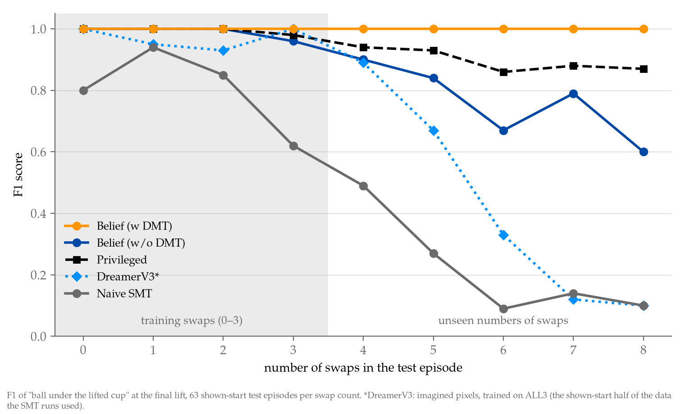
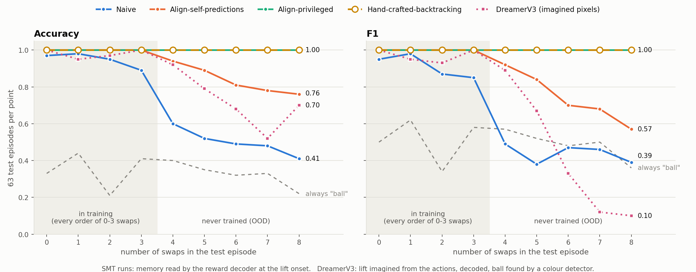
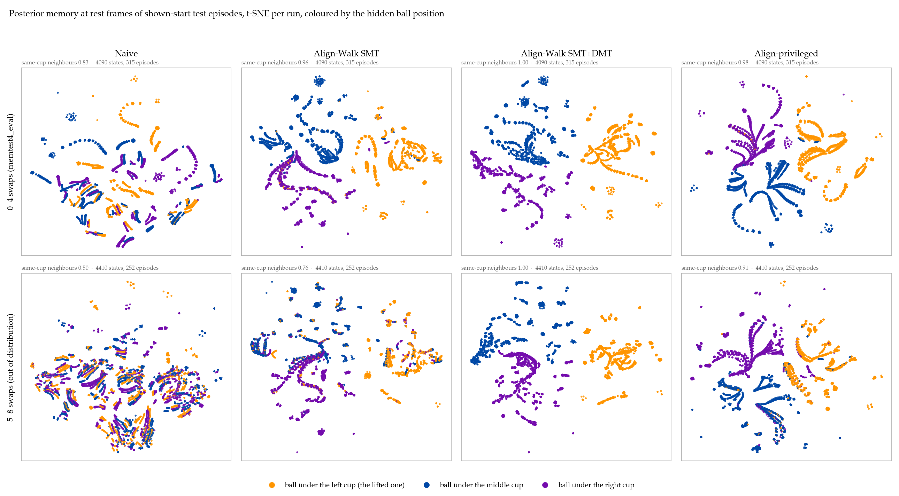
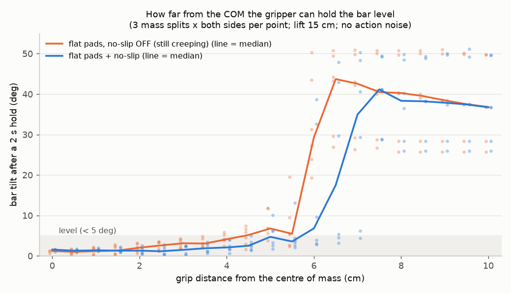
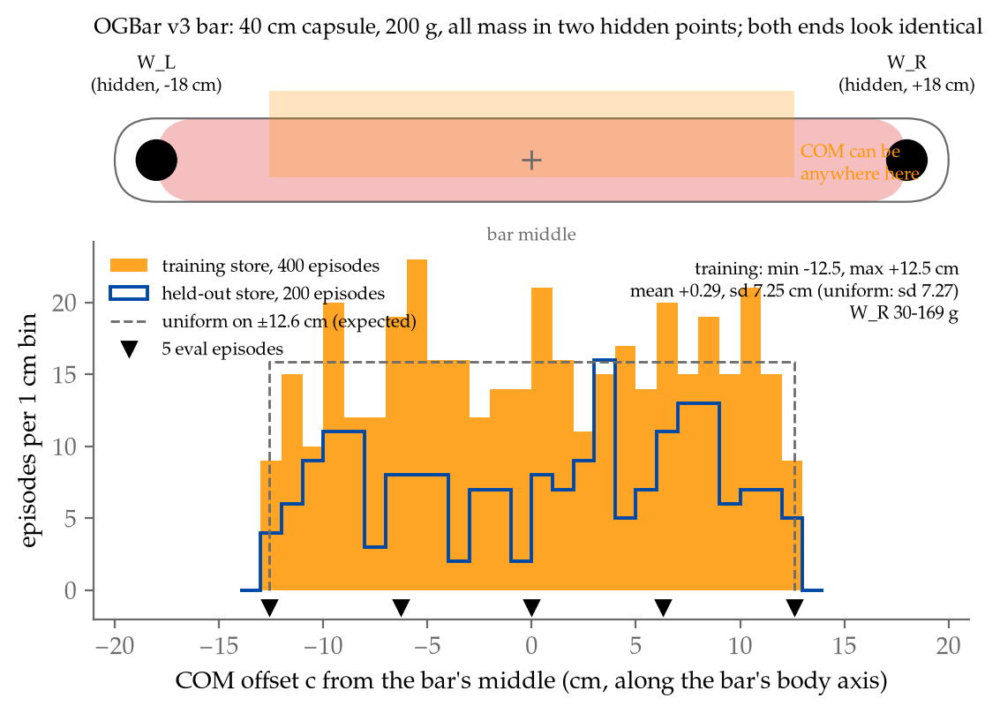
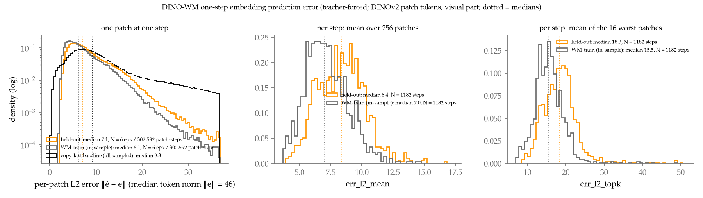

# Main results (figures)

The headline figures, one place to look. Each caption says what is measured, and the linked doc has the details. The images live in [figures/](figures/); the top-level `figures/` folder (everything else) stays local and is not in git.

## Shell game: tracking a hidden ball through swaps

**Label-free belief alignment tracks the ball through 8 swaps; DreamerV3 and Naive SMT collapse beyond the training range.**

- **The measure:** F1 of "the ball is under the lifted cup" at the final lift, on 63 shown-start test episodes per swap count. All models trained on 0–3 swaps, so 4–8 swaps are out of distribution.
- **How the SMT runs are scored:** posterior memory chained over the real frames from frame 0, read by the frozen reward decoder at the lift onset. Data: ALL3-U.
- **The models:**
  - *Belief* = Align-Walk, the best run that uses no privileged labels (splice pairs plus a targeted push on different-ball pairs);
  - *DMT* = the updaters fine-tuned on their own rollouts;
  - *Privileged* = alignment on the true ball position;
  - *DreamerV3* = scored through imagined pixels, trained on ALL3 (the shown-start half of the same data).
- **At 8 swaps:**

  | Belief + DMT | Privileged | Belief alone | DreamerV3 | Naive SMT |
  |---|---|---|---|---|
  | 1.00 | 0.87 | 0.60 | 0.10 | 0.10 |

- Single seed.
- Script: [scripts/plot_f1_by_swaps.py](../scripts/plot_f1_by_swaps.py) (numbers inline). Background: [ALL3U.md](ALL3U.md), [SELF_SIGNATURE.md](SELF_SIGNATURE.md).

**ALL3, trained on every order of 0–3 swaps.**
- Alignment that carries labels through every depth (Align-privileged, Hand-crafted-backtracking) stays at 1.00 out to 8 swaps.
- Align-self-predictions degrades gently (F1 0.57 at 8).
- DreamerV3, scored through imagined pixels, tracks well up to 4 swaps, then falls to 0.10. At 6–8 swaps it mostly imagines an empty cup.
- The dashed grey line is the "always say ball" baseline.
- Details: [ALL3_RESULTS.md](ALL3_RESULTS.md), which also has [the run diagram](figures/all3_runs_diagram.png) and [the label sources](figures/all3_labels.png).

**What the memory holds.**
- **What's plotted:** posterior memories at rest frames of shown-start test episodes, embedded with t-SNE separately per run and coloured by the hidden ball position. The colours are privileged and used for display only.
- **The score:** "same-cup neighbours" = for each state, the share of its 10 nearest states from other episodes whose ball is in the same cup.
- **At 5–8 swaps:** Naive 0.50, Align-Walk 0.76, Align-Walk + DMT 1.00, Align-privileged 0.91.

## OGBar: a bar with a hidden centre of mass

**The hidden property shows only through dynamics.** Gripped within about 4.5 cm of its centre of mass (COM), the bar hangs level; further away, it swings 25–50°. The plot shows tilt after a 2 s hold against grip distance from the COM, with flat pads and no-slip. Details: [OGBAR.md](OGBAR.md).

**Where the COM can be.** A to-scale sketch of the bar (a 40 cm capsule with point masses at ±18 cm), above the per-episode COM offset c, which is uniform on ±12.6 cm. The training store, the held-out store and the 5 eval episodes are marked. *(Made from the old machine's stores.)*

## DINO-WM on OGBar: where its error comes from

**The frozen DINO-WM's one-step embedding error.**
- **What's plotted:** the L2 distance between each predicted DINO patch token and the real next-frame token, over 6 held-out and 6 training-set episodes. Per-episode panels: [error_hist_episodes.png](figures/error_hist_episodes.png).
- **Medians:** held-out 7.1, training set 6.1, copy-last baseline 9.3 (a real token's median norm is 46). The WM beats copy-last mostly in the tail.
- **Its one-step error is blind to the hidden COM.** Open-loop 4-step errors do see it, as a 15–20% rise on lifts whose outcome is open.
- *(Old machine's data.)* Details: [surprise_detectors.md](surprise_detectors.md).
