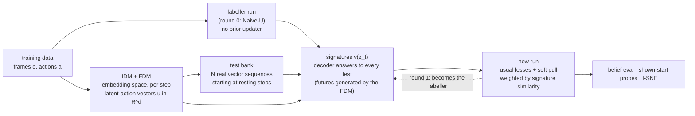

# SELF-SIGNATURE: belief alignment from the model's own predictions of the future

**Status (2026-10-15): PAUSED** — experiments below; see [Where we stopped](#where-we-stopped). It follows [ALL3U.md](ALL3U.md). It is the autonomous replacement for the Hand-crafted labels there. **Everything is continuous:** frame embeddings, latent-action vectors, memory, signatures. There are no codes and no classes anywhere.

## Why

The ALL3-U Hand-crafted run gets every known slot right, but two of its ingredients are written by us:
- **swap segmentation** into 6-frame blocks between still frames, then named by flip rate;
- **belief states:** "a set of positions", 7 classes, update rules for swaps and peeks, and "walk backwards only if the start was shown".

**Goal:** remove both. The only ingredients left are:
- a **latent-action vector** per step from an inverse dynamics model (IDM) in embedding space;
- the model's own **predictions of the future**.

## The idea in one sentence

**Two memory states mean the same thing if the model predicts the same outcome for every possible future.** So a state's meaning is measured by asking the model about many futures and collecting its answers. That list of answers is the state's **signature**. States with similar signatures are pulled together.

**Why the shell game makes this enough.** The belief "where could the ball be" is fully determined by three answers:
- ball under the left cup if we lift now;
- after swapping left with one cup, then lifting;
- after swapping left with the other cup, then lifting.

| situation | lift now | swap left↔middle, lift | swap left↔right, lift |
|---|---|---|---|
| ball known: middle | 0 | 1 | 0 |
| nothing seen | 1/3 | 1/3 | 1/3 |
| left seen empty | 0 | 1/2 | 1/2 |

So 1/3, 1/2 and the collapse after an empty peek all come out of the model's own answers. Nothing about sets or classes is written in.

**Why not compare the futures that actually happened** (the old DTW alignment)? Two states with the same belief usually have *different* real futures, because different swaps follow. The comparison has to apply the **same** future to both states. That's a counterfactual, so the futures have to be supplied rather than observed.

## Symbols

| symbol | meaning |
|---|---|
| e_t | frozen frame embedding at step t (1024 numbers, the R2-Dreamer CNN cache; DINO for OGBar later) |
| a_t | the real action at step t: hold / lift flags |
| u_t | latent action at step t: a vector of d numbers (start with d = 8), from the IDM |
| z_t | the memory (10 × 256) |
| P(z, [a, u]) | the latent-action prior: the one updater that imagines in memory, fed the real action and a latent action. Trained after the labeller, never part of it |
| r(z, future) | the frozen reward decoder's p(ball revealed at the first lifted frame), given memory z and a future sequence of (frame, action) pairs |
| U | a test: a sequence of latent-action vectors (u_1 … u_L), followed by the real lift action |
| v(z_t) | the signature: r(z_t, future made from test U_k), for every test k in the bank |

## Parts

### 1. A latent-action vector space: IDM + forward model (FDM), per step

**The model.** Per step: no blocks, no still-frame rule, no 6.
- **IDM:** reads (e_t, e_{t+1}, a_t) and outputs a **diagonal Gaussian over d = 8 numbers**: a mean μ and a spread σ (log σ clamped) for each. The sample uses the reparameterisation u_t = μ + σ × ε, with ε drawn from a standard normal, one value per number. So the FDM's loss trains μ and σ through the sample.
- **FDM:** ê_{t+1} = FDM(e_t, a_t, u_t).

**Losses:**

| term | what it is | why |
|---|---|---|
| next frame | MSE(ê_{t+1}, e_{t+1}) | u must carry whatever changed that e_t and a_t can't explain |
| bottleneck | β × KL(IDM's Gaussian ‖ standard normal), summed over the d numbers | caps how much u can carry, so it can't simply copy e_{t+1}. With d small and β tuned, u holds "what moved", not the whole next frame |
| transfer | take u from step t and a resting frame e′ from another episode, make ê′ = FDM(e′, a_t, u), then require IDM(e′, ê′, a_t) ≈ u (MSE on the means) | **the same vector must mean the same change from any frame**. Without this, u could encode "the frame at t" and only work where it came from |

**What the space should look like** (checked, never imposed):
- swaps of the same pair lie close together, whichever episode they come from;
- the three pairs, lowering, lifting and "nothing" lie apart;
- "nothing" sits near the zero vector.

**Why in embedding space and not in memory.** ALL3's latent actions were learned through the memory prior, and they failed in two ways:
- imagined swaps only worked from the first state;
- a still-frame version merged the middle↔right swap into "nothing", because that swap doesn't change the answer for the left cup.

In frame space every swap is visible, and cup motion needs no memory (the cups are always in view; only the ball is hidden). So the FDM can generate swaps from *any* resting state.

**Training:** on all training frames, frozen afterwards.

### 2. The test bank: real sequences of latent-action vectors

- **Encode the training episodes** with the IDM (means only) to get one vector per step.
- **Cut sequences of length L** (e.g. L ∈ {6, 12}, about 1 to 2 swaps) starting at a **resting step**, one where the next frame equals the current one. That's a property of the embeddings, not a rule about swaps. It guarantees the cups are at rest, so the sequence can be replayed from any resting state.
- **Pick N = 32 sequences that cover the space:** farthest-point sampling on the flattened sequences, so tests aren't 32 near-copies of the most common motion.
- **A test = that vector sequence, then the real lift action.**
- **No naming anywhere.** A test is just a path through the latent-action space.

### 3. Making a future for a test and asking the decoder

For a state z_t at a resting step, with current frame e_t:
1. **Roll the FDM** from e_t through the test's vectors to get ê_{t+1} … ê_{t+L}: a cup motion that never happened here.
2. **Append the real lift action.**
3. **Read the decoder's memory-only answer at the first lifted frame:** p_k = r(z_t, [(e_t, a), (ê_{t+1}, a), …, (ê_{t+L}, lift)]).
4. **The signature:** v(z_t) = (p_0, p_1, …, p_N), where p_0 is "lift now" (empty test).

The decoder already reads future frames (WINDOW60 layout), so this is the same kind of input it was trained on. Only the frames come from the FDM instead of the camera.

### 4. Alignment from signatures (no classes)

At every resting step of the training data, the signature comes from the **frozen labeller run**. The loss pulls pairs of states in a batch together, weighted by how alike their signatures are:

&nbsp;&nbsp;&nbsp;&nbsp;align = mean over pairs of w_ij × ‖z_i − z_j‖², with w_ij = exp(−‖v_i − v_j‖² / τ)

- **Pull only, weight 0.1,** as in every ALL3 alignment.
- The repo's alignment code already has this soft-attract form (`align_dtw_mode: attract`). Only the distance changes: from DTW to signature distance.

### 5. The loop

- **Round 0:** the labeller is Naive-U, retrained on the rebalanced data (below).
- **The labeller needs no prior updater.** It only has to supply memories (teacher encoder, posterior updater) and answers (reward decoder). All imagining is done by the latent-action prior P, trained afterwards on the frozen labeller's teacher memories. So the labeller run is trained with `coef_prior: 0`. That changes nothing else: the prior loss only ever trains the prior (`src/world_model/models/smt_phase1/losses.py`, gradient table). The same holds for every later labeller and for the aligned runs.
- **Round 1:** the trained run becomes the labeller, its signatures are recomputed, and a fresh run is trained.
- **Stop when the signatures stop changing.** Every round, check signature quality against the truth (for scoring only).

## Data (the only change: rebalancing, not more data)

ALL3-U had only 40 of 768 training episodes reaching the lift in a 1/2 state. Keep 384 shown + 384 closed-start episodes, but place the closed-start peek **early** (after 0 or 1 swaps), so that more swaps involving the left cup follow an empty peek. Same episode count, same swap orders.

## What gets measured, in order

1. **IDM/FDM**, before any SMT training:
   - **the latent-action space:** t-SNE of u coloured by the true event (which pair moved / lower / lift / nothing; for scoring only); a linear probe of the event from u; how much of the d dimensions the bottleneck leaves in use;
   - **transfer:** take the vector of a real swap in one episode, apply it to a resting frame of another, and check that the generated frame is nearest to the real frame of the *same* swap there;
   - FDM rollout error over L steps;
   - a nearest-real-frame check of generated swaps from resting states mid-episode (the case ALL3 failed).
2. **Signatures from the labeller**, before training: distance to the **true** signature (the Bayes answers to the same tests), split by situation (shown, nothing seen, left seen empty, 1/2). If round-0 signatures are far off, the run can't fix them.
3. **The run:**
   - the ALL3-U belief eval (pass = |p − p\*| ≤ 0.1, by category, on 0–3 and 4–8 swaps);
   - shown-start probes on 0–8 swaps (must stay 1.00);
   - t-SNE as in `figures/all3u_tsne_handcrafted_vs_privileged.png`.

**Runs, all on the same rebalanced data and steps:**

| run | alignment |
|---|---|
| Naive | none |
| **Self-signature** (round 0, round 1) | soft pull on the labeller's signatures |
| Signature-privileged (ceiling) | soft pull on the **true** signatures |
| Hand-crafted (ALL3-U, reference) | 7 hand-made classes |

## Risks

- **Labeller quality.** Round-0 signatures are only as honest as Naive-U. It answers 1/3 reasonably on trained depths, poorly at 1/2. The rebalance and the second round are the remedies; step 2 of the measurements shows whether they're enough.
- **A space that only says "something moved".** If the three swap pairs land on top of each other in u, the tests can't tell the cups apart. Check the t-SNE and probe first. If they're merged, lower β (more information through u) or raise d.
- **A space that copies the frame.** If β is too low, u carries the whole next frame and stops meaning "the same change" across frames. The transfer test catches this: the same u applied elsewhere would produce the wrong frame.
- **Signatures read at a drifting moment.** Naive-U's answer changes over resting frames even with nothing moving (training episode 386: 0.98 → 0.04 over five still frames). Read the signature at the first resting frame after motion stops, and also try the average over the resting stretch; compare both against the true signature in measurement step 2.
- **FDM drift over 12 steps.** Cup motion is deterministic, so it should be small. Measured in step 1; if it's large, keep L to one swap.
- **The decoder reading generated frames.** Generated frames could be subtly off the training distribution. Check: at real resting states whose real next swap matches a test, the real-frame answer and the generated-frame answer should agree.

## Carrying over to OGBar

The same three parts apply to [OGBAR_SMT.md](OGBAR_SMT.md):
- the IDM/FDM in DINO space;
- tests = latent-action sequences such as "grasp here, lift";
- signature = the decoder's prediction of the future embedding (e.g. the tilt after a lift).

Two states agree on the bar's centre of mass exactly when they predict the same tilt for every grasp-and-lift test. The OGBar version needs a continuous signature distance and no classes, which is why this design avoids classes from the start.

## First experiment: the latent-action space (2026-10-15)

`scripts/latent_action_idm.py`, run on the ALL3-U training set (31,052 transitions), scored on its 24 held-out episodes. Diagonal Gaussian u, d = 8, transfer loss on, 1,500 steps. Runs: `logdir/latent_actions/smoke_b{1,10,100}/`. Figure: `figures/latent_actions_b10.png`.

**Results** (true events used for scoring only):

| | β = 1 | **β = 10** | β = 100 |
|---|---|---|---|
| held-out next-frame error, moving steps (copy 1880; u = 0: ~540) | 5.7* | 4.2* | 31 |
| information in u at a swap's first step / mid-swap (nats) | 36 / 0.1–0.2* | 16.9 / 0.01 | 5.3 / 0.00 |
| probe: which pair, from u at a swap's first step | 1.00 | 1.00 | 1.00 |
| held-out swaps replayed from **another episode's** resting frame (all 4 mid-arc frames right) | 34/34 | **34/34** | 12/34 (middle–right lost) |

\* from the first smoke run, before the transfer fix; same trend.

**Sampling futures from the common resting frame, hold action** (share of 4,000 samples):

| source of u | nothing | swap L-M | swap L-R | swap M-R |
|---|---|---|---|---|
| real data | 0.78 | 0.05 | 0.05 | 0.05 |
| u ~ N(0, I) (β = 10) | 0.98 | 0.00 | 0.00 | 0.00 |
| u drawn from the real latent actions (β = 10) | 0.79 | 0.11 | 0.05 | 0.05 |

**What it shows:**
- **u carries information only where something is decided.** That's the first step of a swap (which pair), plus lift and lowering. Once an arc has started, the frame predicts the rest, and u drops to about 0. Nobody told it where swaps start.
- **One vector means one swap from anywhere.** A real swap's vector, replayed from another episode's resting frame, reproduces the same swap at every frame (34/34).
- **The swaps live far out:** |μ| ≈ 4–5 standard deviations, with "nothing" at the origin. So **a standard-normal ε almost never produces a swap.** Futures for the k-trajectory test must sample u from the **real latent actions**: a random real u taken at a similar frame under the same action, shared between the two memories in a pair. Drawn that way, the swap frequencies come out close to the real ones. The L-M excess (0.11) comes from lowering vectors drawn from cups-up frames.
- **β = 10 is the setting to keep:** clean replay and the least information. β = 100 loses the middle–right swap.

## Second experiment: the pair test (2026-10-15)

`scripts/signature_pairs_phase1.py`. Labeller: frozen Naive-U (teacher memory). Futures from the β = 10 latent-action model, no snapping, no resting-frame rule.
- 120 training episodes; 1,109 pairs of frames from different episodes with identical embeddings.
- k = 16 shared trajectories per pair, 30 steps each.
- Read: the decoder's memory-only "ball?" at a lift start.
- Truth (scoring only): the ball is under the same cup in both frames. 55% of pairs; 74% among pairs where both memories truly know the cup.

| rule | pairs | marked positive | precision | recall |
|---|---|---|---|---|
| any lift, both p > 0.5 | both know the cup (576) | 545 | 0.75 (= base rate) | 0.96 |
| **first lift only**, both p > 0.5 | both know the cup | 366 | 0.90 | 0.77 |
| **first lift only**, both p > 0.9 | both know the cup | 323 | **0.95** | 0.71 |
| first lift only, both p > 0.9 | at least one unsure (533) | 99 | 0.26 (base 0.33) | 0.15 |
| all agree within 0.1 (ablation) | both know the cup | 333 | **0.99** | 0.77 |
| all agree within 0.1 (ablation) | at least one unsure | 101 | 0.36 | 0.21 |

**Findings:**
- **Reading every lift fails, and not because of drift** (snapping changes nothing: 0.755). The latent action of a real lift carries *what that lift revealed*, because that's exactly what u exists to explain. A lift drawn from another episode therefore makes the forward model draw that episode's ball (or empty cup) into the imagined frames. At the next lift, both memories just read the imagined ball. **Only the first lift of a trajectory is a clean test.** Alternatively, give lifts a u that carries no outcome.
- **With the first lift and p > 0.9, the any rule reaches 0.95 precision** on pairs that know the cup, at 0.71 recall. The remaining errors are the labeller's own tracking mistakes.
- **On pairs where a memory can't know the cup, positives are noise** (0.26 precision against a 0.33 base). They come from Naive-U's overconfident drift (a "don't know" state saying 1) and would pull uncertain states onto known ones. A better labeller (round 1) is the fix, not the rule.
- **The all-agree ablation is the most precise** (0.99) at the same recall. Aleatoric noise didn't hurt it here, because decoder answers on known pairs are near 0 or 1. Its positives among unsure pairs are mostly pairs that share the *belief* ("any of three" both at 1/3) but not the ball position.

## Third experiment: imagine in memory with a latent-action prior (2026-10-15)

**The latent-action prior** (`scripts/train_latent_prior_phase1.py`): P(z_t, [a_t, u_t]) → z_{t+1}.
- It's the phase-1 prior class with u appended to the action, warm-started from Naive-U's own prior. The warm start was a convenience of this run, not part of the method: the labeller doesn't need a prior of its own (see [The loop](#5-the-loop)), so from now on P is trained from scratch. Whether it tracks as well without the warm start is untested.
- Trained to the frozen teacher's z\*_{t+1}; the stage-1 model is untouched.
- Saved at `logdir/world_model/smt_phase1_all3u/naive/latent_prior/`.

**It carries out swaps** (from a real memory right before a real swap in a shown-start training episode, 576 swaps; correct = the memory's "lift now?" afterwards matches the true ball):

| latent actions fed to P | correct |
|---|---|
| that swap's own u | 0.953 |
| **the same pair's swap from another episode** | **0.953** |
| a different pair's swap | 0.366 (follows u, not the truth) |
| u = 0 | 0.559 |

For reference, Naive-U's own memory through *real* swaps is 1.00 / 1.00 / 0.99 / 0.89 correct after 0 / 1 / 2 / 3 swaps.

**Pair test** (`scripts/signature_pairs_prior_phase1.py`): 1,109 frame-matched pairs, 16 shared futures each.
- **Memory is rolled by P.**
- **"Lift now?" is asked at every imagined step,** but only where the frame looks like a frame where real lifts start. At other frames (mid-swap, cups up) the decoder was never asked, and its answer is meaningless.

| futures | precision, both know the cup (base 0.74) | recall | positives among unsure pairs |
|---|---|---|---|
| forward-model frames + onsets drawn near them | 0.78–0.90 | 0.33–0.72 | 49–351 (noise) |
| **replayed real motion segments** (3 per trajectory; their u's through P; read at the segment's real end frame) | **1.000** | 0.43 | **11** |

**Findings:**
- **Frame-space generation was the weak link,** not the prior. Drifting generated frames poison both the reads and the choice of the next latent action.
- **Replaying real segments avoids generation entirely.** A segment runs from a frame whose next frame moves until the frame stops changing; it is chosen so its start frame matches the current frame. The latent actions still come only from the frame-space IDM, but every read happens at a real frame.
- **Unsure memories almost never form positive pairs** (11 of 533), so the pull won't drag "don't know" states onto known ones.
- **Recall (0.43) is limited by valid reads,** about 20% of steps. Raising the number of segments or trajectories trades compute for recall.

## Fourth experiment: pure-noise latent actions (2026-10-15)

`scripts/signature_pairs_prior_phase1.py --futures noise --noise_scale {1,2,4} --reads {all,liftable}`. The user asked for this design: no bank, no replayed segments.
- **Futures:** u = scale × ε, with ε drawn from a standard normal and **the same ε for both memories**, under the hold action.
- **Memory:** rolled by the latent-action prior P.
- **Reads:** "lift now?" at every step, with the pair's start frame as the read token (no frames generated).
- **Pairs:** the same 1,109 frame-matched pairs, 16 trajectories × 10 steps.

| noise on u | trajectories where memory A's answer ever changes | any rule, precision on pairs that know the cup (base 0.74) | recall | any rule, positives among unsure pairs (precision) | all-agree, precision / recall |
|---|---|---|---|---|---|
| ε, standard normal | 19% | 0.84 | 0.63 | 53 (0.42) | 0.96 / 0.83 |
| 2 × ε | 25% | 0.80 | 0.66 | 106 (0.35) | 0.97 / 0.77 |
| 4 × ε | 30% | 0.79 | 0.66 | 139 (0.30) | 0.96 / 0.79 |

Reading only at frames where real lifts start leaves almost no valid reads with the start frame as the token (2–5 positives).

**Findings:**
- **Pure noise is not a valid way to sample a latent action.** The bottleneck pulls each u towards a standard normal, but the real latent actions do not look like one: "nothing" sits near 0 and the three swaps sit in tight spots 4–5 standard deviations out. So noisy u rarely produces a real swap in memory: the answer never changes in 70–80% of trajectories, with an average change of about 0.1.
- **Wider noise moves the memory more, but not into real swaps.** Precision falls (0.84 → 0.79) and unsure pairs get more false positives (53 → 139).
- **What signal there is comes mostly from step 0** (the two memories already agreeing at the start frame), not from the imagined futures. All-agree looks good (0.96) only because the memories barely change.

## Where we stopped

**User decisions** (2026-10-15):
- latent actions are continuous vectors: a diagonal Gaussian, d = 8, sampled with the reparameterisation (no codes);
- a pair is positive as soon as **any** of k = 16 shared-noise trajectories makes both memories say ball; all-agree is the ablation;
- pairs can be any two frames with the same embedding (no resting-frame rule); pairs that never reach a valid read are simply not positive;
- don't worry about drift for now; cap the horizon instead (10 steps);
- imagination happens in **memory**, with a prior updater fed with latent actions;
- the Naive (labeller) run trains **no prior updater** (`coef_prior: 0`); the latent-action prior P is the only prior, trained from scratch afterwards (2026-10-19);
- **not wanted:** the replay of real motion segments (third experiment), and the "same pair from another episode" check. The third experiment's results are recorded but are not the method.

**What works:**
- **The latent-action model** (β = 10): u carries information only at decisions (swap starts, lifts, lowerings); the pair is perfectly decodable; a swap's u reproduces it from another episode's frame.
- **The latent-action prior P** (`logdir/world_model/smt_phase1_all3u/naive/latent_prior/`): it tracks the real memory over 10 steps (average |difference in p| 0.02, against 0.19 without u).
- **The read:** "lift now?" is only meaningful at frames where real lifts start. Elsewhere the decoder's answer is unreliable and can make false positives.

**Open problem:** shared-noise sampling needs a **learned prior over u**, sampled as u = μ_p + σ_p × ε. Here μ_p and σ_p come from the current frame or memory and the action, and are fitted to the IDM's latent actions on real data (KL between the IDM's Gaussian and this prior). Then shared ε lands on real swaps at roughly real frequencies.
- **The catch:** one Gaussian per state cannot cover "nothing" and three separate swaps at once. It needs a small mixture, or an ε that also picks the component.
- **Next when resumed:**
  0. train P from scratch (no warm start) on the labeller's teacher memories, and rerun its tracking check;
  1. train that conditional prior over u;
  2. rerun the fourth experiment with u = μ_p + σ_p × ε;
  3. if any-rule precision on known pairs is high and unsure pairs rarely fire, use those positives as round-0 alignment pairs, train a fresh run, then relabel (round 1).

**Scripts:** `scripts/latent_action_idm.py`, `scripts/train_latent_prior_phase1.py`, `scripts/signature_pairs_phase1.py` (frame-space version), `scripts/signature_pairs_prior_phase1.py` (memory-space; `--futures noise|segments|frames`). Throwaway rollout checks (`onset_rollouts.py`, `joint_rollouts.py`) are in the session scratchpad only.
