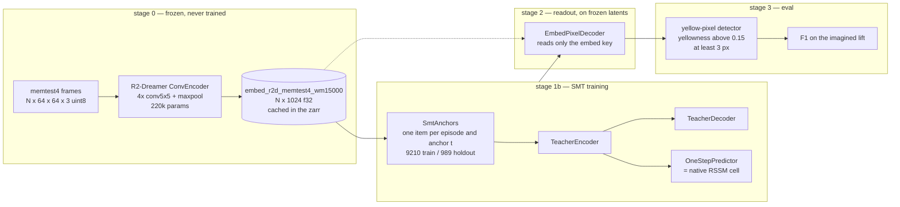
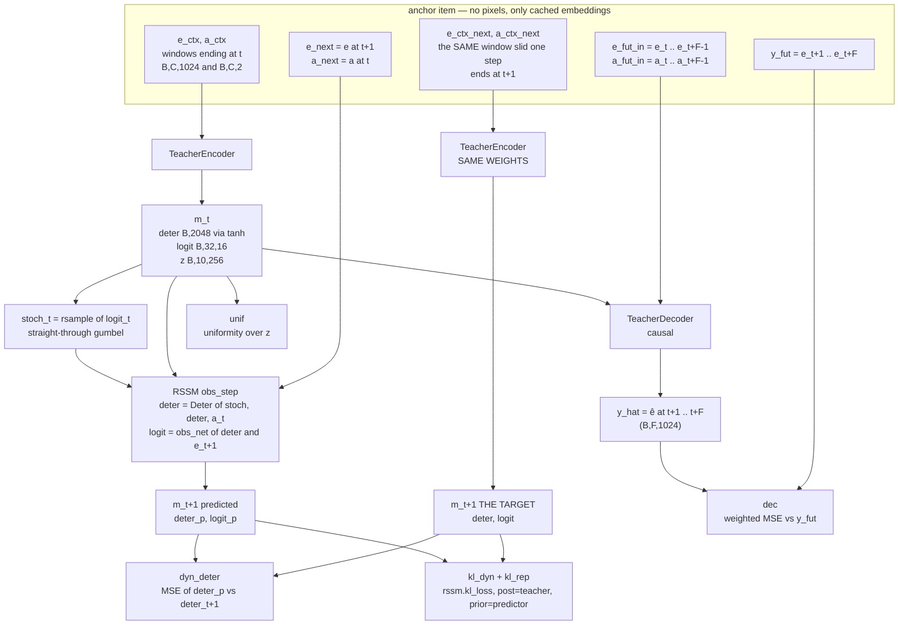
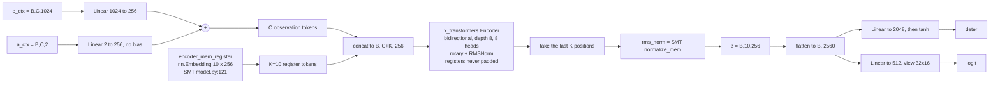
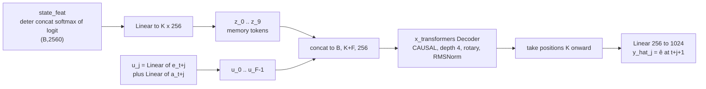
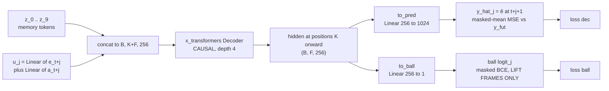
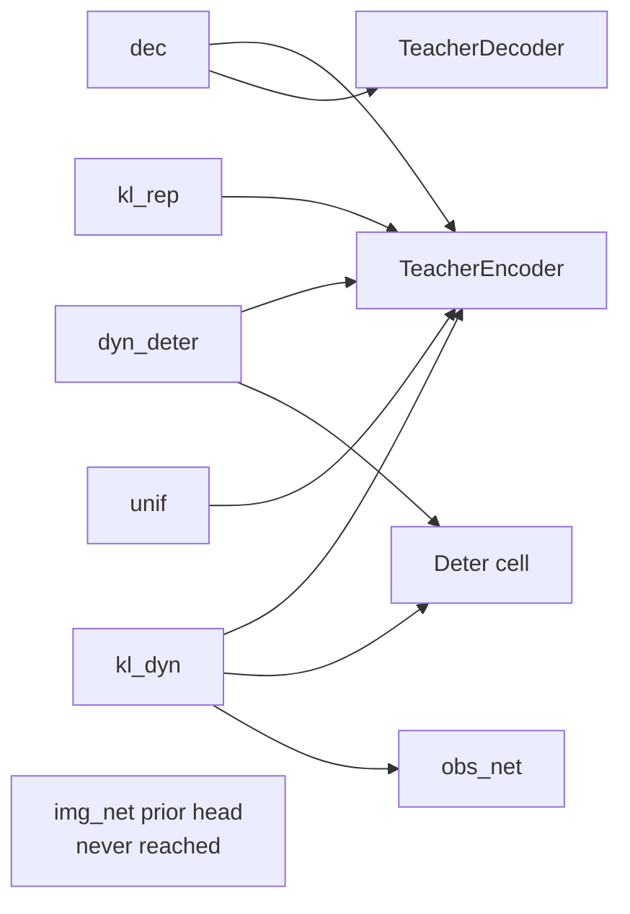
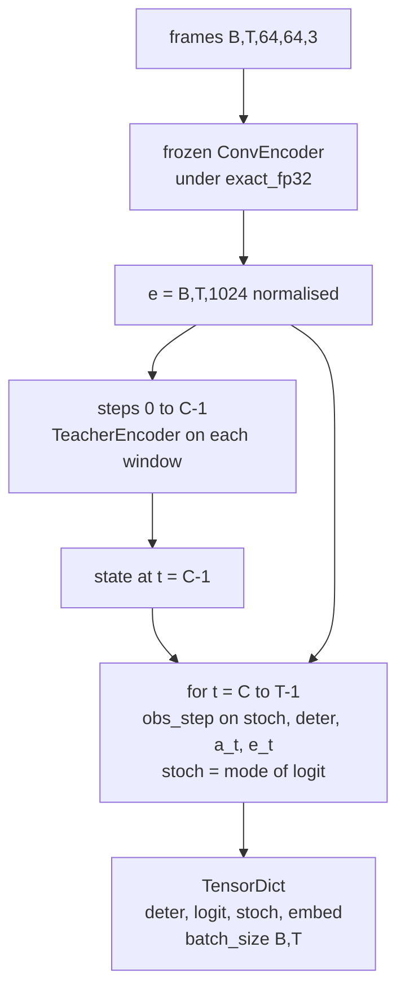
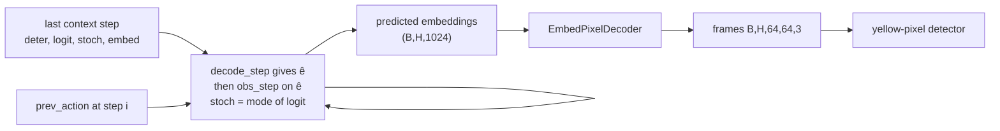

# smt_prelim — architecture

Companion to [SMT_PRELIM.md](SMT_PRELIM.md), which covers the experiment, results and findings.
This file is only the wiring. Line references are to `submodules/smt/src/model.py` (SMT) and
`submodules/r2dreamer/rssm.py` (the Dreamer cell).

Symbols used throughout:

| symbol | meaning | shape |
|---|---|---|
| `e_t` | frozen encoder's **embedding** of frame `t` (not the image) | `1024` |
| `a_t` | action at step `t`, `[cover, lift]` | `2` |
| `m_t` | the Markovian state = `(deter, logit)` | `2048` + `32x16` |
| `z` | the K memory tokens the registers read out | `10 x 256` |
| `ê` | a **predicted** embedding | `1024` |
| `C`, `F` | `ctx_len` (10), `fut_len` (10) | |

---

## 1. Whole pipeline



The pixel decoder reads only `embed`, so it renders real and imagined embeddings through an
identical path — that is what makes `recon` a clean ceiling measurement.

---

## 2. Training: one anchor `t`

This is `smt_losses` in `losses.py`, mirroring `forward_smt` (SMT model.py:294-330).



**The target comes from the encoder, never from the decoder.** `m_{t+1}` is the same
bidirectional encoder on the window slid forward by one — SMT's `x_ctx_next = x[:, 1:Tc+1]`
(model.py:269). Two encoder calls per anchor. The decoder's only job is to define *what `m`
must contain*; without it `m` is unconstrained and the cell would happily match a constant.

---

## 3. Inside the teacher encoder



Two constraints worth knowing:

- `K * d_model = 10 * 256 = 2560 = deter 2048 + 32*16`, which is exactly `rssm.feat_size` and
  satisfies SMT's own `d_model * mem_tokens == mem_size` assertion (model.py:113).
- **`tanh` on the deter head is not cosmetic.** `Deter.forward` returns
  `update * tanh(...) + (1-update) * deter` (rssm.py:71-75), so the cell's `deter` is
  structurally confined to (-1,1). An unbounded target is unreachable, and the only symptom
  would be `deter_r2` stuck near 0.
- The registers are never masked, so no attention row is ever fully masked even when the whole
  context window is padding — SMT gets the same guarantee from `mask_mem = ones` (model.py:135).

---

## 4. The causal decoder's token layout



```
position:  0 .. K-1        K        K+1      ...    K+F-1
token:     z_0 .. z_9      u_0      u_1      ...    u_F-1
                            |        |               |
                            v        v               v
predicts:                  e_t+1    e_t+2    ...    e_t+F
```

**`u_j` deliberately contains `e_{t+j}`, which the decoder is free to copy.** 61% of transitions
in this data are bit-identical, so copying is often exactly right — and that is wanted: the
memory then only has to carry what the decoder's own inputs do *not* reveal, which is the hidden
ball slot. At a lift, `e_t` shows three closed cups and copying gives the wrong answer, so the
only way to reduce that loss is to put the ball's slot into `m`. The task supplies the memory
pressure; no dropout or masking is used beyond padding.

Shifted one token from SMT, whose last memory token predicts the first future token
(`[K-1:-1]`, model.py:157). The shift is where the action goes: predicting `e_{t+1}` requires
`a_t`, and a memory token has nowhere to put it.

---

## 4b. Twin heads: latents and ball visibility

The same causal decoder carries a **second output head**. One forward, one set of per-position
hidden states, two linear read-outs:



With `teacher.twin_ball_decoder: true` the ball head gets its own `Decoder` of identical shape
instead of sharing the trunk; `dec0` was unaffected by sharing, so the default is `false`.

### Where the ball head is supervised

Only inside the **final lift** — the `show` phase, action `[0,1]`, 10 frames, always terminal —
and only once the cup has begun to rise:

```
                    hold (cups down, swaps)          show = THE LIFT
                  ...........................   |---------------------------|
show offset:                                     0    1    2    3   4 .. 9
cup_z_max:        0.05 .................. 0.05  0.05 0.081 0.139 0.170 0.170
ball visible:      no ..................... no   NO   iff  iff   iff   iff
supervised:        --  ..................... --   --  YES  YES   YES   YES
                                                  ^    ^
                        action lands, cup not yet  |    first supervised position:
                        moved -> ball visible in   |    the input token is still a
                        0% of episodes, EXCLUDE ---+    closed cup, so the answer
                                                        can only come from memory
```

`ball_lift = (phase == show) AND (cup_z_max > cup_rest_z)` — 9 supervised positions per episode.
Everywhere else the target is masked out entirely, SMT's no-prediction convention.

**Two metrics, and only one of them is honest.** `ball_acc` averages over all 9 positions, but
from offset 2 onward the decoder's own input token `u_j` already shows the ball, so those are
copyable. **`ball_acc_first`** — accuracy at the first supervised position of each anchor — is
the memory read-out, and it is the number to quote.

### What it measured

Training: `ball_acc_first` 1.000 on train, ~0.91 on the 25-episode holdout. But read at the
**actual eval anchor** on the 315-episode eval set, the same head gives F1 1.000 / 1.000 / 0.828
/ 0.378 / 0.444 for 0/1/2/3/4 cup swaps. The pixel eval tracks that almost exactly (0.930 /
0.945 / 0.828 / 0.421 / 0.444), i.e. **the rollout renders what the state contains and there is
no state-to-pixel gap** — the state simply does not hold the answer past two swaps, even under
direct supervision. Overall the head did not help: F1 0.724 vs 0.757 without it, MCC 0.591 vs
0.635. See SMT_PRELIM.md for the full accounting.

---

## 5. Losses and gradient paths



| term | reaches | scale | notes |
|---|---|---|---|
| `dec` | encoder, decoder | 1.0 | weighted MSE, see below |
| `dyn_deter` | encoder, Deter cell | 0.1 | target **not** detached — SMT's `detach_rnn=False` |
| `kl_dyn` | encoder, Deter cell, obs_net | 1.0 | teacher detached, trains the predictor |
| `kl_rep` | encoder only | 0.1 | predictor detached, trains the teacher |
| `unif` | encoder | 1e-3 | SMT's uniformity over memory tokens |
| `ball` | encoder, decoder | `coef_ball` | masked BCE at lift frames only; never reaches the cell |
| — | `_img_net` never | — | excluded from the optimiser |

Three gradient paths reach the encoder, and all three are required:
**target side** (`dyn_deter`, `kl_rep` via `m_{t+1}`), **input side** (`dyn_deter`, `kl_dyn`
back through the cell to `m_t`), and **decoder** (`dec` via `from_state`). The only detaches in
the objective are the two inside `rssm.kl_loss`, which are the KL-balancing split.
`kl_free = 0.0`, not the native 1.0 — a 1-nat budget would let the predictor lose a 3-way slot
label for free. Verify this table after any edit to `losses.py`.

**Reweighting** (`loss.reweight: nomem`) multiplies each prediction by what the memory buys:

```
w_j = stopgrad( || decode_without_memory(...)_j - y_j ||^2 )
```
Cup arcs are predictable without memory so they get a small weight; ball reveals are not, so they
get a large one. Normalised to mean 1, uniform until `reweight_warmup`. Uses no labels.

---

## 6. Inference

### observe — building the state over real frames



This is SMT's `read_with_teacher_rnn` (model.py:415-433): the teacher encodes a **prefix**, then
the cell is **unrolled** over real observations. `observe_mode: window` is the ablation that
re-encodes a fresh window every step and never uses the cell — memory then caps at `ctx_len`.
Causality is verified by randomising every frame after `t` and checking the state at `t` is
bit-identical.

### imagine — open loop



No real frame or embedding enters after the context — verified by randomising every frame past
the context and checking the output is unchanged. `stoch` carries the **mode** forward, not the
gumbel sample `obs_step` returns internally, or the rollout is stochastic and F1 wobbles run to
run.

---

## 7. Map to SMT

| ours | SMT | note |
|---|---|---|
| `TeacherEncoder` | `Teacher.encode` (model.py:124) | Linear token embedding instead of `nn.Embedding`; actions added |
| `TeacherDecoder` | `Teacher.decode` (model.py:148) | shifted one token to carry the action |
| `OneStepPredictor` | `RNN.rnn_update` (model.py:200) | **replaced** by the RSSM cell — see finding 6.4 |
| `smt_losses` | `forward_smt` (model.py:294) | MSE split into deter-MSE + stoch-KL |
| `observe` recurrent | `read_with_teacher_rnn` (model.py:415) | |
| `imagine` | `write_with_teacher_rnn` (model.py:438) | |
| — | `forward_dmt` (model.py:353) | DMT not implemented |

The substitution in row 3 is the consequential one. SMT's `rnn_update` is a transformer over
`[memory tokens ; new token] -> new memory tokens`, so the observation is a token the memory
attends to directly. The RSSM instead routes every observation through a `32x16` categorical
sample, and in these runs that categorical collapsed to uniform — making the chained state
provably blind to observations. See SMT_PRELIM.md finding 6.4.
